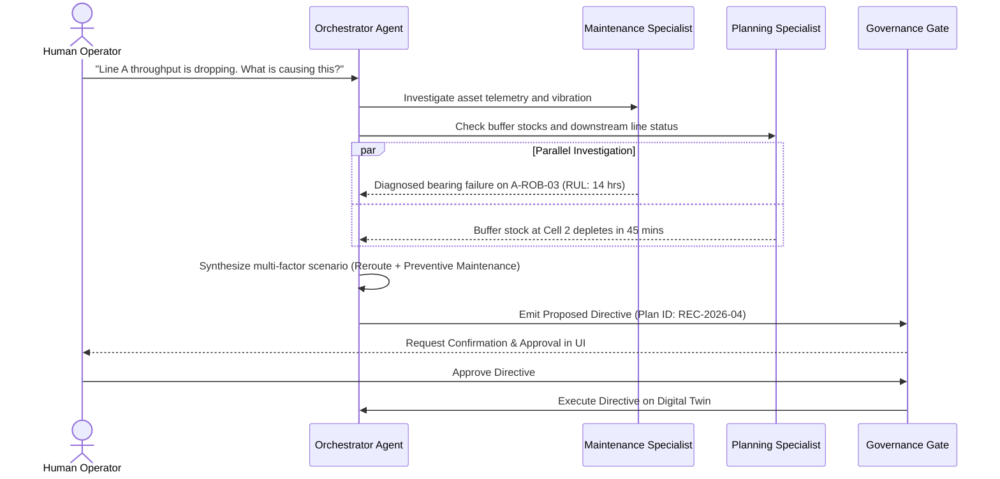

# Multi-Agent Swarm & Governance (`backend/agents`)

The **Agents** module orchestrates autonomous specialist agents to investigate anomalies, simulate outcomes, and propose high-confidence operational plans.

It enforces strict **agent governance**, ensuring that AI systems act as expert advisors while keeping final operational decisions under human control.

---

## Directory Structure

```
backend/agents/
├── orchestrator/    # Root coordinator agent; goal decomposition and specialist delegation
├── supervisors/     # Domain specialist agents:
│   ├── maintenance_supervisor.py   # Diagnoses machinery wear, computes RUL, and checks manuals
│   ├── quality_supervisor.py       # Investigates scrap spikes and correlates with sensor anomalies
│   ├── production_supervisor.py    # Analyzes throughput bottlenecks and evaluates reroutes
│   └── supply_supervisor.py        # Identifies buffer stockouts and recommends purchase orders
├── state/           # State graphs and session persistence (LangGraph / ADK state machines)
└── governance/      # Human-In-The-Loop (HITL) gate, proposal validation, and immutable audit logs
```

---

## Multi-Agent Interaction Workflow



---

## Safety & Audit Invariants

1. **No Autonomous Equipment Control**: Directives execute only on the digital twin simulation. Physical equipment is never written to directly.
2. **Deterministic Fact Grounding**: Specialists only provide figures derived from deterministic domain algorithms or verified tool executions. Hallucinated figures trigger automatic validation failures.
3. **Traceability**: Every recommendation logs the generating agent, the tool call trace, input parameters, timestamp, and human reviewer identity.
