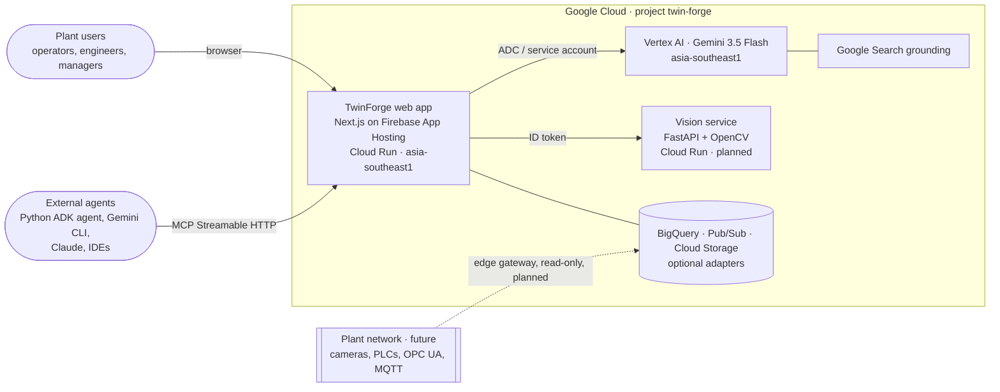
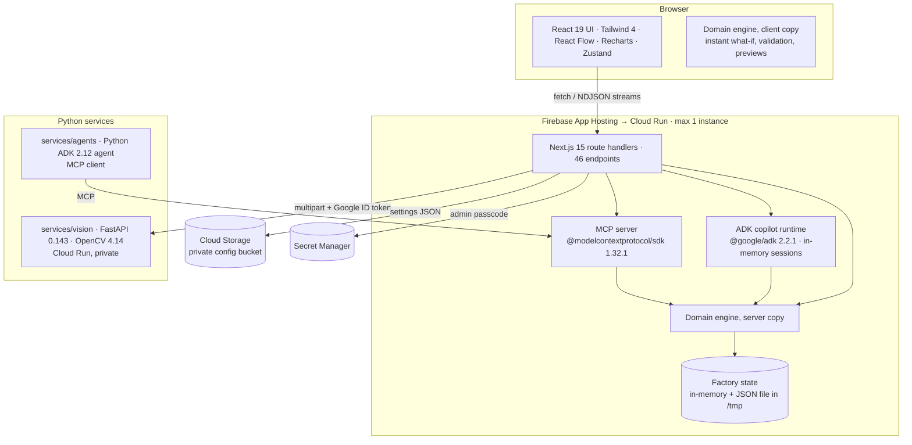
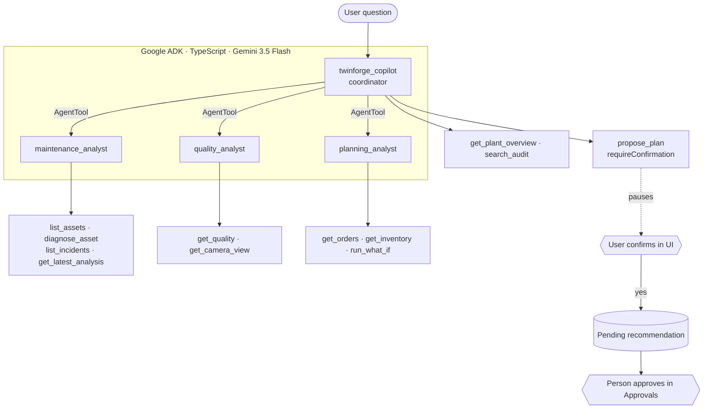

# TwinForge AI: architecture and design

**Version:** 14 Oct 2026, `main`. **Live:** https://twinforge--twin-forge.asia-southeast1.hosted.app

TwinForge AI is an agentic digital twin for manufacturing. It mirrors a factory as a live model, finds problems early, simulates the alternatives, and proposes a plan that a person approves before anything changes. New users build their own twin from a drawing and a description. Operators can ask a multi-agent copilot about the plant, and external agents can use the same tools over MCP.

This document explains how the system is put together and why. Related design documents:
- [Twin Builder](twin-builder.md)
- [Python services plan](python-services-plan.md)
- [README](../README.md): setup and a walkthrough

---

## 1. Design principles

Every part of the system follows these rules. When a design choice was unclear, these decided it.

> **Our Principle:** Language models explain, extract and orchestrate. Numbers come from configured rules. Suggestions come from the ontology. Decisions come from people.

1. **Numbers come from configured rules, never from a model.** Every metric, forecast, cost and probability is computed by deterministic rules and domain models. Language models explain, extract and orchestrate. Suggestions are grounded in the governed supply chain and plant ontology. Every figure stated is checked against verified rules.
2. **People decide.** Agents may *propose*. Approving, rejecting and rolling back are human actions in the UI, recorded in the audit trail. No code path lets an agent approve its own proposal.
3. **Nothing touches real equipment.** Approved plans change the twin, not machines. Data connectors are read-only by design; the platform has no write path to PLCs.
4. **Say what is real.** The demo runs on a simulated plant and says so everywhere. Integrations show *Connected* only after a real call succeeds. Agent output carries provenance (where each element came from), and figures that can't be traced are flagged.
5. **Same input, same output.** The plant model, scenarios, quality model, Twin Builder compiler and machine-vision checks are deterministic. Tests assert byte-identical results.
6. **Degrade honestly.** Every AI feature has a stated fallback (template mode, deterministic narrative, station-log review) and announces when it is used.

---

## 2. System context



| Actor | Uses |
|---|---|
| Plant user | The web app: command center, twin views, AI operations, what-if simulator, approvals, Visual Quality, Twin Builder, copilot |
| External agent | `POST /api/mcp`: the same 12 deterministic tools the copilot uses |
| Vertex AI (Gemini) | Agent briefing text, Twin Builder (reading drawings, grounded research, drafting, chat edits), ADK copilot, optional footage review |
| Vision service (Python) | Deterministic OpenCV checks behind `POST /api/vision/inspect` |

---

## 3. Containers and deployment



| Unit | Tech | Runs where | State |
|---|---|---|---|
| Web app (UI and API) | Next.js 15.5, React 19, TypeScript 5.9 | Firebase App Hosting (Cloud Run), `asia-southeast1`, 0–1 instances, 1 CPU, 1 GiB | One `FactoryState` in memory, written atomically to `/tmp/twinforge` |
| Domain engine | Pure TypeScript (`src/domain`, ≈ 8,900 lines) | Server, and in the browser for instant what-if and validation | None (functions over state) |
| ADK copilot | `@google/adk` 2.2.1 + Gemini on Vertex | Inside the web app | In-memory ADK sessions |
| MCP server | `@modelcontextprotocol/sdk` 1.32.1, Streamable HTTP, stateless | Inside the web app at `/api/mcp` | None |
| Vision service | Python 3.13, FastAPI, OpenCV, uv-locked | Cloud Run `twinforge-vision`, `asia-southeast1`, private (`--no-allow-unauthenticated`), 0–2 instances | None |
| Python ADK agent | `google-adk[mcp]` 2.12 | Local CLI or `adk web`; Agent Engine possible | ADK sessions |

**Why one instance?** The demo keeps state in memory so every visitor sees the same factory. Two instances would diverge. Section 14 describes the move to a shared store.

---

## 4. Code structure

```
src/
  domain/                 pure, deterministic, isomorphic (server + browser), unit-tested
    world.ts              plant physics: flow, rates, scrap attribution, energy, wear, trips
    telemetry.ts          live advance, measured readings, trend estimation, incidents
    simulation.ts         scenario engine, calibration, metrics, scoring, ranking
    scenarios.ts          preset plans (reference, continue, preventive, reroute)
    anomaly.ts            diagnostics: OLS trend, change point, z-score, time to trip
    agents/               six analysis agents + orchestrator pipeline (deterministic)
    quality.ts, vision.ts inspection model, cameras, visual reviews
    archetypes.ts         16 machine archetypes (physics, sensors, defects, rate ranges)
    builder/              Twin Builder: spec, validation, compile, templates, edit ops, agent workflow
    tools/                agent tool layer (12 tools) + numeric grounding check
    seed.ts               plan → FactoryState builder (demo and generated twins)
    layout.ts             floor layout shared by the isometric, 3D and Playground views
    rules.ts, crisis.ts   maintenance rules; the scripted demo crisis
    errors.ts             DomainError (status-carrying domain error)
    recommendations.ts, actions.ts, commands.ts, kpis.ts, audit.ts
  server/                 server-only adapters
    http.ts               route wrapper, error contract, NDJSON responses
    runtime.ts            runtime facts: serverless detection, data dir, atomic writes
    store.ts              state persistence
    ai/                   provider-neutral LLM port (llm.ts) and provider config
    builder/ai.ts         Twin Builder prompts and schemas (BuilderAi adapter)
    copilot/              ADK agents, runner, ProviderLlm adapter
    tools/store.ts        binds the tool layer to live state (ToolStore adapter)
    integrations/         BigQuery, Pub/Sub, GCS, MQTT, vision service; honest status
  lib/contracts.ts        wire types shared by server and browser (copilot stream, landing story)
  app/                    Next.js routes: pages + /api/*
  client/                 Zustand stores (factory, UI, simulator, builder, playground, copilot, admin),
                          the typed API client and the integrations client
  components/             UI: shell, twin, iso, three (3D), playground, vision, builder, copilot…
services/
  vision/                 Python FastAPI + OpenCV service (tests, Dockerfile)
  agents/                 Python ADK agent that uses TwinForge over MCP
tests/ e2e/               Vitest (117) and Playwright (16); services/vision has pytest (16)
docs/                     this document, Twin Builder, Python services plan
```

**Layering rule:** `domain` imports nothing from `server`, `app`, `components` or `client`; the browser code imports nothing from `server`; `server` imports nothing from `components`. Shared wire types live in `lib/contracts.ts`. Route handlers stay thin: validate input (zod), call a domain function, persist, respond. The browser imports the same domain code so the simulator and builder respond instantly. Checked on 16 Oct 2026: 202 modules, 728 runtime import edges, no circular imports.

**Ports and adapters.** The domain defines the interfaces it needs and the server implements them: `ToolStore` (state access for the copilot and MCP tools; adapter `server/tools/store.ts`, fakes in tests), `BuilderAi` (Twin Builder AI steps; adapter `server/builder/ai.ts`), `PipelineDeps` (clock, pacing and narration for the analysis pipeline). Language-model calls go through one provider-neutral port (`server/ai/llm.ts`).

---

## 5. Domain model

`FactoryState` (`src/domain/types.ts`) is the single source of truth. Every page renders from it.

| Group | Entities |
|---|---|
| Structure | `profile`, `lines` (process "assembly" lines feeding an optional packing line), `assets` (machines with sensors, thresholds, condition), `connections`, `cameras` |
| Demand and supply | `products` (with BOMs via line capabilities), `inventory` (stock, reorder point, inbound POs, expedite options), `orders` |
| Time series | `telemetry` (per asset, 10-min history), `latest`, `production` (hourly per line, scrap attributed by cause), `healthHistory` |
| Operations | `incidents`, `workOrders`, `maintenanceHistory`, `directives` (approved actions being executed), `finishedGoods` |
| Intelligence | `analyses` (agent runs), `scenarioRuns`, `recommendations`, `visionReviews` |
| Governance | `audit` (every alert, finding, decision and action), `costModel`, `counters` |
| Twin Builder | `twinSpec` (the reviewed spec with provenance), `dataPlan` (planned connections) |

---

## 6. The plant engine

### 6.1 Physics (`world.ts`)
The same step function drives the live twin (2 simulated minutes per 4 s tick) and the what-if engine (15-minute steps):
- Each line's rate is the minimum of its machines' rates. A line stops for maintenance, a changeover, an unplanned trip, or missing materials.
- **Wear.** Hidden condition (vibration and temperature excess, and their slopes) degrades a machine. Crossing its trip threshold causes an unplanned stop of `unplannedRepairHours`.
- **Scrap.** Each machine's vibration adds to its line's scrap rate. Scrap is attributed by cause (baseline process or a specific machine), and the quality model turns that into defect classes.
- **Materials and orders.** Materials are consumed per BOM. Packed output fills orders by priority and due time, and late units carry penalties.
- **Energy.** Each machine draws idle and load power, plus extra draw from friction when it vibrates.

### 6.2 What the system knows vs what is true
Agents and forecasts never read the hidden condition. They see measured telemetry with seeded noise. The scenario engine calibrates each machine from that telemetry (OLS trend plus a change-point test) and simulates forward. The demo crisis is therefore discovered from data, not looked up.

### 6.3 Scenarios and scoring
- **Plans:** a reference plan (the asset assumed healthy), plus *continue*, *preventive maintenance* and *reroute + maintain*. Custom plans can change the maintenance start and length, speed, reroute share, expedited POs, order quantity and priority, energy price and horizon.
- **Score:** delivery 40%, cost 30%, risk 20%, sustainability 10%. Plans that run into a trip are demoted (an asset-protection policy).
- **Demo crisis outcome:**
  - *Continue:* A-ROB-03 trips at about h+16.5, with roughly 700 late units and about $58K cost.
  - *Reroute + maintain:* 0 late units, about $13.7K cost, score about 82.

### 6.4 From approval to execution
Approving a recommendation creates **directives** (maintenance window, allocation change, speed change). The plant engine executes them on the twin over simulated time. Each directive can be rolled back, and each step is written to the audit trail.

### 6.5 Automation rules (Playground)
Rules are part of the compiled twin (`state.rules`, engine ids) and act only through mechanisms the engine already has:
- **Inventory and connector rules** run at the end of every `stepWorld`, so the live twin and What-If runs behave the same. An inventory rule adds a purchase order (whole lots, due after the lead time) when stock plus open orders falls below its level. A connector rule creates allocation or speed **directives** tagged with its id: *divert* re-allocates another process line (half its own mix, half the stopped line's products it can make), *slow* and *pause* set the line's machines' speed (a line at speed 0 reports *idle*); the directives end when the condition clears, with 80% hysteresis on buffer limits. Rule state (`state.ruleRuntime`) is cloned into simulations, so a What-If run never changes the live rules.
- **Maintenance rules** (`src/domain/rules.ts`) watch measured health and vibration after each live step and, once per crossing, simulate the preset plans and create a **pending** preventive recommendation with source *rule*. Approval stays with a person.
- Rule events are audited as *Automation rule*; at most 12 finished rule directives are kept. A twin without rules has no `rules` field, so the demo seed is unchanged.

---

## 7. Agentic layers

TwinForge has three kinds of agent, each with a clear trust boundary.

| Layer | What decides | What the model does | Guardrails |
|---|---|---|---|
| **Analysis pipeline** (6 agents: maintenance, quality, production, supply, energy, orchestrator) | Deterministic code computes every finding, forecast and ranking | Gemini writes the briefing text only | JSON schema; every figure must appear in the computed facts, otherwise a deterministic narrative is used |
| **Twin Builder** | Deterministic validation and compiler | Reads drawings, researches with Google Search, drafts a spec, turns chat into edit operations | Fixed archetype catalog, provenance per element, citations from grounding metadata only, validated edit operations, human review before build |
| **ADK copilot and MCP** | 12 deterministic tools | Chooses tools, delegates to specialists, explains results | Read tools can't change state; one proposal tool behind ADK's confirmation gate; answers checked for untraced figures; no approve, execute or equipment tools exist |

### 7.1 Analysis pipeline
`OBSERVE → INVESTIGATE → PREDICT → SIMULATE → RECOMMEND → HUMAN APPROVAL`
- **How it runs.** The pipeline works on a frozen snapshot and streams each stage's real output as NDJSON. Only a person can approve the resulting recommendation.
- **Speed.** Small pauses between stages are for readability only.
- **Briefing.** Gemini 3.5 Flash with low thinking writes it in about 5.5 s, followed by the grounding check.

### 7.2 Twin Builder
Full design: [twin-builder.md](twin-builder.md).
- **Workflow:** read the drawing (multimodal), research the industry (Google Search grounding, cited), draft a `TwinSpec`, then validate.
- **Model draft, code decides.** Code resolves ids, blueprint boxes and citations. A claim the model can't back (a non-existent drawing element, an invalid citation) is downgraded to *assumption*.
- **Mobile robots.** Fleets the requirements or drawing describe are drafted with a type, move, line and count; if the model leaves them out, a keyword reader adds them and says so. They are reviewed and edited like machines.
- **Edits.** Chat, manual and Playground edits share 28 validated edit operations (including placing, connecting and splitting machines, robot routes, and adding, updating and removing rules).
- **Playground.** A sandbox draft of the spec (`src/client/playground.ts`, undo/redo, kept in the browser) edited on an SVG floor plan that uses the same `layoutIso` as the twin views. The demo plant is read back into a spec (`specFromState`). Hand-placed machines carry `pos` (x, y, rotation) into `state.layout`; the layout then derives bays, straight or L-shaped conveyors, the merge into packing, stores and dock from the machines. **Apply** uses `/api/builder/build`.
- **Build.** The compiler (`compileSpec`) builds the twin with the same engine as the demo.
- **Measured:** about 78 s for a full draft with research on the live site.

### 7.3 ADK copilot (multi-agent)



- **Agents.** A coordinator with three specialists, each wrapped as an ADK `AgentTool`. Specialists can run in parallel (observed). The coordinator has its own tools for overview, audit search and proposals.
- **Tools.** All 12 are deterministic functions from `src/domain/tools/twin-tools.ts`. The model sees Gemini function schemas generated from the tools' zod shapes, and every call is validated again in code.
- **Human in the loop.** `propose_plan` uses ADK's `requireConfirmation`: the run pauses with an `adk_request_confirmation` event, the UI shows a confirmation card, and the run resumes only with the user's answer. Even then it only creates a *pending* recommendation.
- **Transparency.** Every tool call, including the specialists' calls inside their own runners, streams to the UI through a per-request `AsyncLocalStorage` sink. Each answer shows its tool trace.
- **Grounding.** Figures in the answer are checked against the deterministic tool outputs of the whole conversation, within the precision stated. A specialist's own text doesn't count as a source. A difference between two tool figures is accepted but labelled *derived*. Anything else is flagged as not traced.
- **Sessions.** ADK `InMemorySessionService`, one session per browser conversation, so follow-up questions work.
- **Measured:** 8–23 s per answer, and confirmation turns take about 2 s. In tests, 19 of 19 figures were traced.

### 7.4 MCP server and the Python ADK agent
- **MCP server.** `/api/mcp` serves the same 12 tools over MCP Streamable HTTP (stateless, JSON responses). Read tools carry `readOnlyHint: true`. `propose_plan` is the only non-read tool, and it only creates a pending item. Optional bearer token: `TWINFORGE_MCP_TOKEN`.
- **Python ADK agent.** `services/agents` uses `McpToolset` with a read-only tool filter. It shows the twin being operated by a separate agent, in another language and process, with no code shared. Measured: 4 tool calls and a grounded answer in about 15 s.

---

## 8. Twin views, 3D and mobile robots

- **Four views of one state:** Topology (React Flow), Isometric (SVG), Floor plan and **3D** (three.js through React Three Fiber, loaded only when the tab opens). The isometric and 3D views share one layout (`layoutIso`) and one machine-part library (`machineParts`), so they always agree; the 3D view adds orbit, pan, zoom, top view, focus and a turntable, with animated robot arms, belts and robots. Labels are DOM elements positioned by a per-frame projector (one React tree). Without WebGL the tab says so and points to the other views.
- **Realism without assets.** Physically based materials shared across the scene (`materials.ts`: painted and brushed steel, rubber, glass, emissive HMI screens), a procedurally generated concrete floor and wall panels, studio lighting from drei `Lightformer`s rendered once into an environment map (no HDR download), and inward-facing walls so the wall between the camera and the plant is culled as you orbit (columns follow the same rule). Robot arms use forward kinematics over the archetype's joint pose for a pick-and-place motion. **High** quality adds rounded edges, conveyor rollers, N8AO ambient occlusion, bloom and a larger shadow map; **Standard** is chosen when WebGL runs in software or the device has few cores, and drei's `PerformanceMonitor` drops to it on a sustained frame-rate decline. The choice is remembered per browser.
- **Mobile robots (`src/domain/intralogistics.ts`).** A twin built with the Twin Builder has exactly the fleets its reviewed spec asks for (`state.mobileRobots`: AMRs, AGVs, automated forklifts or tuggers for kitting, transfer to packing or finished goods to the dock); a twin without them has none. The demo plant, which predates the builder, gets a derived fleet (a kitting AMR per process line, a pallet AMR per packing line) so its seed stays byte-identical. Trips per hour = line output ÷ units per trip (60 per kit or tote, 120 per pallet), shared across a fleet; a robot parks with the reason when its line is down, in maintenance or starved. Routes keep to the aisles (`amr-paths.ts`). The animation runs at real speed while the plant clock runs 30× faster, which the view states. A fleet manager (VDA 5050 or a vendor API) would replace this with real positions.

---

## 9. Visual quality and cameras

- **Inspection model.** Scrap attribution in the plant model is mapped to defect classes. Electronics plants use IPC-A-610J Class 2, and other industries use their machines' own defect classes. From these, the model computes FPY, DPMO, rolled throughput yield, a Pareto and vibration ↔ reject correlations (r = 0.89 in the crisis).
- **Cameras in the twin.** Area CCTV, AOI and final inspection, radiometric thermal, dock and stores, shown in all three views. Each camera has one of three sources:
  - **Twin feed** (default): rendered from twin state and labelled *simulated*.
  - **Reference footage**: a looped, openly licensed clip of a comparable real factory from the footage library (`src/domain/footage.ts`, files in `public/footage`). It is badged *reference footage*, credited with author, source and license, and described as "not this plant" everywhere, including the copilot's camera tool. Analytics shown next to it still come from the twin.
  - **Plant gateway**: HLS, MP4 or MJPEG over https from a gateway such as MediaMTX on the plant network.
  - Every live view and every source switch is audited, and face blur and retention are recorded per camera, reflecting the DPDP Act.
- **CCTV control room** (`/control-room`, admin). A video wall of every camera (wall or focus layout), per-camera and bulk source switching, the footage library with credits, a log of switches and views, and visual QA on the selected feed: Gemini review or the OpenCV motion check on the reference clip (`POST /api/cameras/:id/analyze`). Results become reviews awaiting a person, like any other.
- **Reviews.** Three sources, each waiting for a human to confirm or dismiss:
  - deterministic station-log reviews
  - Gemini footage review (advisory)
  - OpenCV checks from the Python vision service: golden-board comparison with ORB and RANSAC alignment, barcode and QR reading with an indicative ISO/IEC 15416 grade, image quality, video stoppages

---

## 10. Key flows

### 10.1 Live telemetry loop
Every 4 s, the browser calls `POST /api/telemetry/tick`. The server advances the plant 2 simulated minutes (throttled server-side, so many tabs don't speed it up) and returns the new state. The store applies it, and every page re-renders from the same state.

### 10.2 Crisis → decision
1. **Demo controls → crisis:** the scripted bearing damage on A-ROB-03 starts.
2. **AI Operations:** the pipeline streams its stages and commits an analysis, a scenario run and a pending recommendation.
3. **What-If:** the user explores plans; the same engine runs in the browser, so results are instant.
4. **Approvals:** a person approves, the twin executes the directives, and the result is audited.

### 10.3 Twin Builder
Upload, then `POST /api/builder/draft` (NDJSON: read, research, draft, validate), then review and edit (client-side operations and validation, chat through `/api/builder/refine`), then `POST /api/builder/build`. The compiled twin replaces the factory.

### 10.4 Copilot
`POST /api/copilot {sessionId, message}` streams NDJSON events: `tool_call`, `tool_result`, `confirm`, `answer` with grounding, then `done`. A confirmation is sent as `POST /api/copilot {sessionId, confirm: {callId, confirmed}}`.

---

## 11. API surface (46 route handlers)

| Area | Endpoints |
|---|---|
| Factory and simulation | `GET/POST /api/factory`, `/api/factory/reset`, `/api/demo/crisis`, `/api/telemetry/{tick,live}`, `/api/sim/advance`, `/api/faults` |
| Assets | `/api/assets`, `/api/assets/:id`, `/api/assets/:id/telemetry`, `/api/connections`, `/api/anomalies`, `/api/documents[/:id]` |
| Intelligence | `/api/agents/analyze` (NDJSON), `/api/scenarios`, `/api/scenarios/compare`, `/api/recommendations[/:id/{approve,reject,rollback}]`, `/api/kpis`, `/api/audit` |
| Quality and vision | `/api/quality`, `/api/cameras[/:id[/view,/analyze]]`, `/api/cameras/streams` (admin, bulk switch), `/api/vision/{analyze,inspect,review-log}`, `/api/vision/reviews/:id` |
| Twin Builder | `/api/builder`, `/api/builder/{draft,refine,validate,build}` |
| Agents | `/api/copilot` (NDJSON), `/api/mcp` (MCP) |
| Platform | `/api/health`, `/api/integrations`, `/api/integrations/test`, `/api/integrations/settings` (admin), `/api/admin/session`, `/api` (index) |

Validation errors return 400 with field issues, missing admin 401, unknown ids 404, conflicts 409, unsupported media 415 and oversize 413. Unconfigured AI returns 503 with a clear message.

---

## 12. AI configuration and behaviour

**Providers.** Every AI feature goes through one provider-neutral layer (`src/server/ai/llm.ts`), chosen on **Integrations → AI model provider** (or `AI_PROVIDER`):

| Provider | Protocol | Images / PDF / video | Web research | Copilot |
|---|---|---|---|---|
| Gemini on Vertex AI (default) | `@google/genai`, ADC | ✓ / ✓ / ✓ | Google Search grounding | ADK native `Gemini` |
| Gemini API (AI Studio key; free tier) | `@google/genai`, API key | ✓ / ✓ / ✓ | Google Search grounding | ADK native `Gemini` |
| Claude | Anthropic Messages API; JSON via a forced tool | ✓ / ✓ / frames | `web_search_20250305`, citations | ADK through `ProviderLlm` |
| OpenAI | Responses API; `json_schema` output | ✓ / ✓ / frames | `web_search`, url citations | ADK through `ProviderLlm` |
| OpenAI-compatible (OpenRouter, Groq, Ollama…) | Chat Completions; `json_object` + schema in the prompt | ✓ / – / frames | – (stage skipped, with the reason) | ADK through `ProviderLlm` |

`ProviderLlm` (`src/server/copilot/provider-llm.ts`) is an ADK `BaseLlm` that translates Gemini-format contents, function declarations and function calls to Claude or OpenAI tool calling and back, so the same coordinator, specialists and confirmation gate run on any provider. Providers that can't watch video get a contact sheet of four frames captured in the browser, with their times. Every structured result is still validated with zod, and every number still goes through the grounding check. **AI_ENABLED=false** turns all AI calls off (no AI cost); the demo then runs on its deterministic fallbacks.

| Setting | Value | Why |
|---|---|---|
| Model | `gemini-3.5-flash` on Vertex AI | Current fast Gemini model; `gemini-2.5-flash` is being retired |
| Region | `asia-southeast1` | Co-located with App Hosting. The `global` endpoint stalled on about 1 in 4 test calls, and `us-central1` doesn't serve this model. |
| Auth | Application Default Credentials; App Hosting service account has `roles/aiplatform.user` | No keys in code or the browser |
| Retries | One retry on stall, 429 or 5xx | Recovers transient Vertex stalls |
| Output budget | ≥ 4,096 tokens (8–16K for builder calls) | On Gemini 3.x, thinking tokens count toward the output limit |
| Thinking | Low for the briefing and copilot; default for builder drafting | Speed where reasoning is light |
| Structured output | `responseJsonSchema` + zod on every structured call | Malformed output never reaches state |
| Grounded research | `googleSearch` tool; citations from grounding metadata; Search suggestions displayed | Required by Google's terms; prevents invented sources |
| Fallbacks | Deterministic narrative, template mode, station-log review | The demo works without AI |

**Cost.** Per-token pricing on every provider; web research adds per-search fees (Google Search grounding, Claude web search at $10 per 1,000). Turn AI off in Integrations to stop AI spending entirely, or use the Gemini API free tier. A billing budget alert is recommended.

---

## 13. Security, safety and privacy

- **No control path.** There are no endpoints or tools that write to equipment. Connectors are read-only by construction, and approved plans execute only in the twin.
- **Human approval.** Recommendations from the pipeline, the operator or the copilot are always *pending* until a person approves them. Approve, reject and rollback exist only as UI routes; no agent tool can call them.
- **Audit.** Alerts, agent findings, scenario runs, proposals (with who proposed them), decisions, executed actions, camera live views and visual reviews are all audited.
- **Admin.** Camera sources and integration settings change only with an admin session: a passcode from Secret Manager unlocks an HMAC-signed, httpOnly, SameSite=Strict cookie for 8 hours, with constant-time comparison and a rate limit on wrong attempts. Without a passcode, admin is open in local development and disabled on Cloud Run.
- **Secrets.** Server-side only. `.env.local` is git-ignored, and the browser never sees credentials. Secret settings entered in the UI (Gemini API key, MCP token) are write-only: never returned by the API or written to the audit trail. They are saved in a private bucket with public access prevention; production would move them to Secret Manager.
- **Outbound URLs.** Stream and service URLs must be https (localhost for testing), without credentials, and the metadata server is refused.
- **Uploads.** Size and type limits: 15 MB for images and drawings, 30 MB for video. Files are processed in memory or a temp file and never stored. The vision service is private on Cloud Run (unauthenticated calls get 403) and is called with Google ID tokens; only the App Hosting service account has `roles/run.invoker`.
- **Privacy.** Camera face blur, retention and purpose are recorded per camera, and live views are audited, following India's DPDP Act. Video analytics are advisory and never safety functions (IEC 61496 / ISO 13849).
- **Known gaps (demo scope).** There is no per-user login: viewing, running scenarios and approving are open to anyone with the URL, and the MCP endpoint is open until a token is set on the Integrations page. Production would add Firebase Auth, per-tenant authorization and a token on MCP.

---

## 14. Persistence and scaling

**Today:**
- integration settings saved from the UI are durable (private Cloud Storage object), loaded at server start
- one factory per deployment
- state held in memory and in an atomic JSON file (on serverless, `/tmp`)
- max 1 instance
- the factory resets when Cloud Run recycles the instance
- copilot sessions are in memory

**Next step to production:**
1. Move `FactoryState` to Firestore (one document tree per factory, transactions for `mutate`). `store.ts` is the only file that reads or writes state.
2. Firebase Auth and per-factory access rules; multiple factories per tenant.
3. ADK `DatabaseSessionService` or Vertex AI sessions for the copilot.
4. Lift the instance cap and run the plant clock as a scheduled job (Cloud Scheduler), not per browser tick.
5. Pub/Sub ingestion from the edge gateway for real telemetry (the adapter already exists).

---

## 15. Testing

| Suite | Count | Covers |
|---|---|---|
| Vitest (`tests/`) | 117 | Seed reproducibility; physics, KPIs and trend estimation; scenario outcomes, sensitivity and ranking; agent pipeline; approvals, rejection and rollback; LLM grounding and fallback; quality and cameras; Twin Builder templates, validation, compile and agent workflow with recorded responses; the tool layer (read-only guarantee, proposal semantics, argument validation); numeric grounding; admin sessions (signing, expiry, rate limit); settings overrides, validation and secret handling; camera sources and the footage library; stock-outs reported once; Playground edits and the four rule kinds in the plant model |
| Playwright (`e2e/`) | 16 | The Playground from palette drag to applied twin; every page renders with no console errors; guided crisis demo; reset; API validation; iso view and theme; landing story; cameras and Visual Quality; Twin Builder end to end; MCP protocol; ADK copilot with a grounded answer (runs when Gemini is configured); CCTV control room switching to reference footage and back; integration settings from the UI, including the AI provider picker; the 3D view with mobile robots; Twin Builder robots end to end; the phone notice |
| pytest (`services/vision`) | 16 | Golden comparison (missing part, rotated part, lighting), codes, quality, video stoppage, determinism, API limits |

The e2e suite runs against local production builds and against the live URL (`E2E_BASE_URL`). With AI on, the Twin Builder and copilot tests exercise real Gemini.

---

## 16. Deployment and operations

| Task | How |
|---|---|
| Deploy the web app | Push to `main`, then `firebase apphosting:rollouts:create twinforge --git-commit <sha> --force --project twin-forge` |
| Configuration | Integrations page for integration settings (admin); `apphosting.yaml` for deployment defaults, instance limits and secrets; `.env.local` for local work (git-ignored) |
| AI access | Vertex AI API enabled; ADC locally (`gcloud auth application-default login`); App Hosting service account has `roles/aiplatform.user` |
| Health | `GET /api/health`; Integrations page with real connectivity tests |
| Vision service | `gcloud run deploy twinforge-vision --source services/vision …` ([python-services-plan.md](python-services-plan.md), Phase 2). The App Hosting service account has `roles/run.invoker`; the URL is set on the Integrations page. |
| Integration settings | Integrations page (admin). Saved to `gs://twin-forge-twinforge-config/twinforge/settings.json` (`TWINFORGE_CONFIG_BUCKET`), loaded at server start (`src/instrumentation.ts`). |
| Admin passcode | Secret Manager `twinforge-admin-key`, mapped to `TWINFORGE_ADMIN_KEY` in `apphosting.yaml`. Read it with `gcloud secrets versions access latest --secret twinforge-admin-key --project twin-forge`; rotate with `firebase apphosting:secrets:set twinforge-admin-key`. |
| Python ADK agent | `cd services/agents && uv run python ask.py "…"` or `uv run adk web` |

---

## 17. Key design decisions

| Decision | Alternatives considered | Reason |
|---|---|---|
| One Next.js app owns state, API and the engine | Separate FastAPI backend | The engine runs in the browser too, for instant what-if; a second backend would duplicate it or add a network round trip per change |
| Deterministic engine; LLMs only explain, extract and orchestrate | LLM agents that reason about numbers | Reproducibility and no invented figures; every number is testable |
| Machine-archetype library + spec compiler for "any factory" | Full process-graph engine | Covers most discrete and packaging plants in days, not weeks, without rewriting the engine the demo depends on |
| ADK in TypeScript, inside the app | Python ADK on Agent Engine | Same process as the tools and state, so no extra service or latency. Python ADK is still used, as an external MCP client, to prove interoperability. |
| Coordinator + specialists as `AgentTool`s | One agent with all tools; agent transfer | The coordinator keeps control of the conversation and the confirmation gate; specialists stay focused and can run in parallel |
| One tool layer shared by the copilot and MCP | Separate tool sets | A single place to enforce validation, read-only semantics and grounding |
| `asia-southeast1` for Vertex | `global` | Measured stalls on `global`; co-located with hosting |
| Python only where its libraries win (OpenCV, edge protocols) | Python everywhere | Keeps one language on the critical path |
| Integration settings in the UI, overriding the environment | Environment variables only; Firestore | Admins enable and test integrations without a redeploy; the deployment still works with no saved settings; one small JSON object in a private bucket needs no new database |
| One admin passcode in Secret Manager | Firebase Auth with roles; no protection | Protects configuration changes on a public demo URL in hours, not days; Firebase Auth/IAP is the production path |
| 3D view built on the isometric layout (three.js / React Three Fiber, loaded on demand) | Separate 3D scene or glTF models | One layout and part library for both views, so they never disagree; no model assets to license; three.js costs nothing until the tab opens |
| Mobile robots derived from material flow | AMRs as stored assets | Keeps the seeded demo unchanged and the robots consistent with line output; a fleet-manager adapter can replace it |
| Reference footage, labelled, for camera demos | Simulated video only; unlabelled stock video | Real video makes visual QA demonstrable; labelling it as another facility's footage keeps the demo honest |

---

## 18. Limitations and roadmap

**Limitations:**
- simulated plant data only
- single tenant; only configuration changes are behind an admin passcode (no per-user login)
- per-instance factory state (integration settings are durable)
- machines on a line run in series
- no automatic re-ordering in the demo plant (purchased parts without an open purchase order run out around h+55–61 and the lines starve); Playground inventory rules add it to a rebuilt twin
- camera footage is reference video from other facilities; live camera analytics need the edge worker
- connectors other than Pub/Sub are planned, not built

**Roadmap:**
1. Default replenishment for the demo plant, using the Playground's inventory rule, so long runs don't starve.
2. Firestore state, Firebase Auth, and multiple factories.
3. Twin Builder self-correction loop on ADK: draft, validate, repair, repeat.
4. Edge gateway: OPC UA, Modbus and MQTT read-only, publishing to Pub/Sub; live camera analytics at the edge.
5. Learned inspection (anomaly detection trained on good parts), validated with an MSA study before use; Gemma on-prem for plants without cloud access.
6. A2A endpoint so enterprise agents can delegate to TwinForge.
