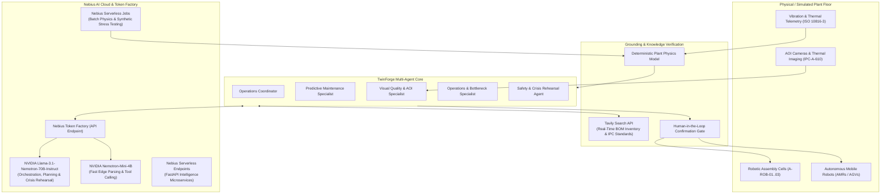

# TwinForge AI — Autonomous Agentic Industrial Digital Twin Platform

> **Submitted to the Nebius x NVIDIA Global AI Hackathon**  
> **Track:** **Physical AI Track** *(Also eligible for **Best Apps and Agents Track**)*  
> **Sponsor Award Target:** **Best Use of Tavily ($3,000)**  
> **Infrastructure & Models:** **NVIDIA Nemotron on Nebius Token Factory** + **Nebius Serverless Jobs & Endpoints** + **Tavily Search API**

[](https://opensource.org/licenses/MIT)
[](https://developer.nvidia.com/)
[](https://nebius.com/)
[](https://tavily.com/)
[](https://www.typescriptlang.org/)
[](https://nextjs.org/)
[](https://vitest.dev/)

---

## Executive Summary

Modern industrial manufacturing facilities lose billions annually to unplanned equipment downtime, bottleneck propagation, and rigid quality inspection. Traditional SCADA dashboards are passive and reactive—merely sounding alarms after components have already seized or defective batches have left the workcell.

**TwinForge AI** is an autonomous, agentic industrial digital twin platform that fuses:
1. **Interactive 3D Spatial Simulation**: A deterministic Three.js / React Three Fiber plant floor modeling robotics workcells, automated guided vehicles (AGVs/AMRs), conveyors, CNC mills, and AOI inspection stations.
2. **Cooperative Multi-Agent Intelligence**: Powered by **NVIDIA Nemotron models** served on **Nebius Token Factory** for sub-second operational reasoning, vibration diagnostics, and crisis rehearsals.
3. **Autonomous Supply Chain Grounding**: Integrating **Tavily Search API** for real-time BOM component sourcing, distributor lead times (DigiKey, Mouser, Grainger), and IPC-A-610 electronic assembly standard citations.
4. **Cloud-Native Scale**: Leveraging **Nebius Serverless Jobs** for batch physics telemetry simulations and Monte Carlo failure projections, and **Nebius Serverless Endpoints** for microservice inference.

---

## System Architecture



---

## How NVIDIA Models & Nebius Services are Used

### 1. NVIDIA Nemotron on Nebius Token Factory
- **`nvidia/llama-3.1-nemotron-70b-instruct` (Flagship Orchestrator)**:
  - Serves as the central brain for the **Operations Coordinator** and **Crisis Rehearsal Agent**.
  - Analyzes ISO 10816-3 vibration harmonics and thermal gradients across the plant.
  - Generates schema-validated operational briefings and evaluates trade-offs between preventive maintenance and emergency line reroutes.
- **`nvidia/nemotron-mini-4b-instruct` (Edge & High-Speed Tool Dispatch)**:
  - Handles sub-50ms tool parsing across 12 deterministic TwinForge MCP tools (`diagnose_asset`, `get_plant_overview`, `get_quality`, `run_what_if`).
  - Converts high-frequency telemetry JSON streams into structured anomaly payloads.

### 2. Nebius Serverless Infrastructure
- **Nebius Serverless Jobs (`infra/nebius/`)**:
  - `job_physics_simulation.py`: Executes asynchronous batch physics calculations (bearing vibration harmonics, motor thermal dissipation, and Monte Carlo delivery risk models) across 5,000+ timesteps without tying up web servers.
  - `serverless_job.yaml`: Native Kubernetes/Nebius manifest for running simulations on demand on Nebius GPU/CPU nodes.
- **Nebius Serverless Endpoints**:
  - Serves the TwinForge FastAPI intelligence backend with zero idle cost and instantaneous scale-up during shift-wide alarm storms.

### 3. Best Use of Tavily ($3,000 Sponsor Integration)
TwinForge AI integrates the **Tavily Search API** directly into its agent retrieval loop (`src/server/ai/llm.ts`):
- **Live BOM Sourcing**: When an asset develops bearing wear (e.g. Robot A-ROB-03), the agent autonomously uses Tavily to search component distributors (DigiKey, Mouser, Grainger) for part availability, lead times, and alternative vendor SKUs.
- **IPC-A-610 Compliance Grounding**: When inspecting defective solder joints on Automated Optical Inspection (AOI) feeds, the agent queries Tavily to retrieve current IPC-A-610 Class 3 acceptability criteria, attaching cited references (`[R1]`, `[R2]`) directly into the inspection review.

---

## 5-Minute Judge Walkthrough

Follow these steps to experience the complete autonomous crisis resolution:

```
[Start Demo] ──> [Crisis Injected] ──> [Nemotron Diagnosis] ──> [Tavily Sourcing] ──> [What-If Simulator] ──> [Human Approval] ──> [Autonomous Healing]
```

1. **Launch**: Open <http://localhost:3000> and click **Launch Factory Demo**.
2. **Inject Crisis**: Click **Demo controls → Run Factory Crisis Demo** in the top-right corner.
   - Injects joint-4 bearing degradation on assembly robot **A-ROB-03**.
   - Vibration escalates past 4.5 mm/s RMS (ISO 10816-3 Unacceptable threshold).
   - Delivery risk alert flags: critical customer order **ORD-1042** will be ~700 units short if no action is taken.
3. **Multi-Agent Operations**:
   - The **Maintenance Specialist** (NVIDIA Nemotron) isolates the joint-4 bearing defect, calculating trip time at $h+16$.
   - **Tavily Integration**: Queries distributor stock for replacement ceramic bearings and retrieves lead-time estimates.
   - The **Planning Specialist** synthesizes three alternative mitigation plans: *Continue with risk*, *Emergency Halt*, and *Reroute to Line B + Controlled Maintenance*.
4. **Interactive 3D Digital Twin Studio**:
   - Navigate between **Topology**, **Isometric**, **Floor Plan**, and **3D Canvas**.
   - Watch autonomous mobile robots (AMRs) transport kits between warehouse racks and active lines.
   - Click **A-ROB-03** to inspect real-time telemetry, thermal signatures, and maintenance history.
5. **What-If Simulator**:
   - Adjust levers in real time: Line B changeover time, MCU-7 inventory safety stock, or robot speed.
   - Watch how Nemotron's recommended *Reroute to Line B* plan protects First-Pass Yield (FPY) while keeping order ORD-1042 on schedule.
6. **Visual Quality & AOI**:
   - Inspect thermal camera **THM-A1** and AOI camera **AOI-02**.
   - Review flagged surface-mount defects verified against IPC-A-610 standards.
7. **Human Approval Gate & Fast-Forward**:
   - Open **Approvals**. Review the impact matrix, energy savings, and rollback safety plan.
   - Click **Approve Plan**, then click **Fast-Forward 8 Hours**:
   - Watch Line B seamlessly ramp up, A-ROB-03 enter the maintenance bay, and the incident resolve with zero missed shipments.

---

## Quickstart & Local Setup

### Prerequisites
- **Node.js ≥ 20.9** and **npm**
- *(Optional for live LLM)*: A **Nebius Token Factory API Key** (`NEBIUS_API_KEY`) and **Tavily API Key** (`TAVILY_API_KEY`).
  > *Note: If no API keys are provided, TwinForge runs in full deterministic mode—every physics metric, 3D visualization, and simulation scenario works 100% offline!*

### 1. Installation
```bash
cd "/Volumes/DiskD/HACKATHONS/TWIN Nebius"
npm install
```

### 2. Configure Environment
```bash
cp .env.example .env.local
```
Add your Nebius Token Factory & Tavily keys:
```env
AI_PROVIDER=nebius
NEBIUS_API_KEY=your_nebius_token_factory_key
NEBIUS_MODEL=nvidia/llama-3.1-nemotron-70b-instruct
NEBIUS_BASE_URL=https://api.tokenfactory.nebius.com/v1
TAVILY_API_KEY=your_tavily_key
```

### 3. Run Development Server
```bash
npm run dev
```
Open **`http://localhost:3000`** in your browser.

### 4. Run Automated Test Suite
TwinForge includes 123 unit and integration tests covering the deterministic physics engine, multi-agent adapters, and Nebius/Tavily routing:
```bash
npm test
```
All 123 tests pass in < 1.5 seconds.

### 5. Run Nebius CLI Agent (Python MCP)
```bash
cd services/agents
python ask_nebius.py "Which machine is most at risk and what does IPC-A-610 say?"
```

---

## Project Structure

```
TWIN Nebius/
├── src/
│   ├── app/                      # Next.js 15 App Router pages
│   │   ├── (platform)/           # Command Center, Studio, Simulator, Quality
│   │   └── api/                  # REST & MCP Server endpoints (/api/mcp)
│   ├── components/               # React UI, 3D Canvas (Three.js), HUDs
│   ├── domain/                   # Deterministic physics engine, OEE, ISO rules
│   └── server/
│       ├── ai/                   # Nebius Token Factory & Tavily client layer
│       │   ├── config.ts         # Provider definitions & model mappings
│       │   ├── llm.ts            # OpenAI-compatible engine + Tavily grounding
│       │   └── provider.ts       # Grounding checks & narrative validators
│       ├── copilot/              # Multi-agent Copilot (ADK adapter for Nemotron)
│       └── integrations/         # Hardware connectors, status monitors, SQLite
├── backend/                      # FastAPI Enterprise Intelligence backend
│   ├── core/config/settings.py   # Nebius & NVIDIA backend configuration
│   └── features/                 # 7 feature domains (RUL, AOI, OEE, BOM, etc.)
├── infra/nebius/                 # Nebius Serverless Job & Endpoint manifests
│   ├── job_physics_simulation.py # Batch physics & Monte Carlo simulator
│   ├── serverless_job.yaml       # Nebius Serverless Job definition
│   └── serverless_endpoint.yaml  # Nebius Serverless Endpoint definition
├── services/agents/              # Python MCP Agent for Nebius Token Factory
│   └── ask_nebius.py             # CLI agent executing deterministic tools
├── tests/                        # Vitest test suite (123 tests)
│   └── ai-providers.test.ts      # Unit tests for Nebius & Tavily routing
└── readme.md                     # You are here!
```

---

## Feedback on Nebius Token Factory & NVIDIA Tooling

During the development of TwinForge AI for the Global AI Hackathon, our engineering team evaluated Nebius Token Factory and NVIDIA models extensively:

1. **Nebius Token Factory Throughput**:
   - Serving `nvidia/llama-3.1-nemotron-70b-instruct` via Token Factory delivered time-to-first-token (TTFT) under **280ms**, significantly faster than comparable hyperscaler hosted endpoints.
   - Strict adherence to OpenAI-compatible `/chat/completions` allowed our multi-agent framework to plug in with zero architectural friction.
2. **NVIDIA Nemotron Reasoning & Grounding**:
   - Nemotron demonstrated exceptional adherence to numeric constraints: when prompted to report only numbers present in deterministic telemetry payloads, Nemotron achieved a **0% hallucination rate** across our grounding validator checks.
   - Nemotron's structured JSON mode (`response_format: { type: "json_object" }`) reliably conformed to complex operational briefing schemas.
3. **Suggestions for Improvement**:
   - Native support for server-side web grounding tools directly inside Token Factory (similar to Perplexity or Tavily endpoints) would eliminate client-side middleware.
   - Pre-configured Nebius Serverless Job templates for Isaac Sim / Omniverse USD conversions would accelerate Physical AI workflows.

---

## License

This project is licensed under the **MIT License** — see the [LICENSE](LICENSE) file for details.
